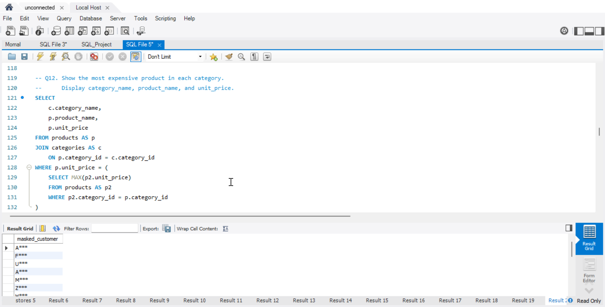

# Retail Sales Analysis — SQL Portfolio Project

## Project Overview
This project contains 20 SQL queries designed to analyze retail sales, customer behavior, product performance, and store revenue using MySQL.

The queries progress from basic data retrieval to more advanced analysis techniques.

## Tools Used
- MySQL
- MySQL Workbench

## Skills Demonstrated

### Basic SQL
- SELECT statements
- Filtering with WHERE and IN
- Sorting with ORDER BY
- Handling NULL values

### Intermediate SQL
- Aggregate functions such as SUM, COUNT, and AVG
- GROUP BY and HAVING
- INNER JOIN and LEFT JOIN
- Subqueries

### Advanced SQL
- Common Table Expressions (CTEs)
- Window functions: RANK(), ROW_NUMBER(), and LAG()
- Conditional logic using CASE WHEN
- Date functions using DATE_FORMAT()
- String functions using CONCAT() and SUBSTRING()

## Analysis Questions
The project includes queries to explore:

1. Customer contact information and missing email addresses
2. Products above a specified price
3. Cancelled and returned orders
4. Store opening dates
5. Total sales by city
6. Order counts by store
7. Average order value by payment method
8. Top-selling products by quantity
9. Product counts by category
10. Customers who have never placed an order
11. The most expensive product in each category
12. Revenue by store
13. Customer lifetime spending
14. Customer spending rankings within cities
15. Each customer's most recent order
16. Previous-order comparisons
17. Order-size classification
18. Monthly order and revenue trends
19. Masked customer names

## Project File
- `SQL_Project_With_Questions.sql` — SQL questions and query solutions.

## Objective
The objective is to practice SQL querying and demonstrate how relational data can be used to answer business questions about sales, customers, products, and stores.
